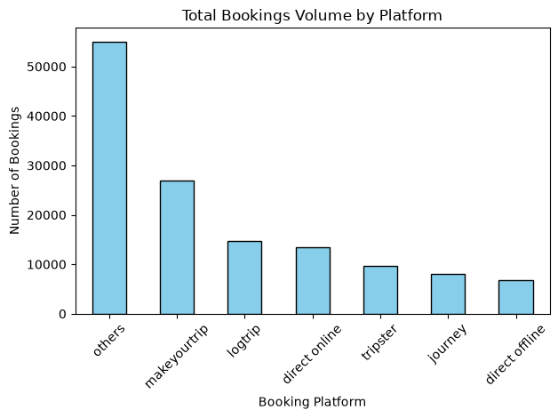

# 🏨 Exploratory-Data-Analytics-EDA-in-Hospitality-Domain-Using-Python-Pandas

Data Engineering & Analytics Project

## Welcome 👋
Welcome to my Hospitality Domain Data Analytics & Pipeline Project.

This repository showcases my hands-on work with Python, Pandas, Matplotlib, and data engineering fundamentals through a practical end-to-end data sanitization project.

Feel free to explore the project and its development steps.

## 📌 Project Overview
An end-to-end Data Sanitization and Exploratory Data Analysis (EDA) pipeline using Python and Pandas. The pipeline is built to profile, clean, and validate massive hospitality transactional datasets by removing structural system corruptions and managing mathematical revenue outliers.

## 🛠️ Technologies
- Python 3.x
- Pandas
- Matplotlib
- Git & GitHub
- Jupyter Notebook

## ⚙️ Key Components
- Core data profiling and integrity discovery
- Identification and removal of logical anomalies (e.g., zero-guest checks)
- Column data type harmonization using numeric coercion tools
- Implementation of the 3-Sigma statistical rule for outlier mitigation
- Channel volume and revenue distribution charting
- Dynamic data pipeline verification via diagnostic monitoring

## 📂 Project Structure
```text
Exploratory-Data-Analytics-EDA-in-Hospitality-Domain-Using-Python-Pandas/
├── datasets/
│   └── .gitkeep
├── hospitality_pipeline.py
├── download.png
└── README.md
```

## 🏗️ Data Processing Architecture

### 📊 Data Architecture: Cleaning, Transformation, and Evaluation Layers
The transactional data goes through a rigid sanitization framework to ensure analytics readiness:

1. **Raw Ingestion Layer:** Loading the baseline operational dataset directly into memory using relative Pandas workflows.
2. **Structural Validation Layer:** Dropping active input corruptions where core values (like total guest counts) fall below baseline business rules.
3. **Statistical Purge Layer (3-Sigma Method):** Computing rolling standard deviations to locate multi-million currency glitches, establishing an automatic threshold ceiling, and stabilizing transactional variance.
4. **Consumption Layer:** Preparing structured outputs for clean charting and downstream BI platform connections.

### 📊 Booking Distribution Analytics
Here is the baseline channel volume visual tracking overall booking performance:



## 👤 About Me
MSc graduate in Petrochemical with professional experience in IT, Sales, and business development, currently transitioning into **Data Analytics**. Skilled in SQL, PostgreSQL, Power BI, Python, and Tableau.
